# BlinkitSales-PBI: Sales, Delivery, Experience and Marketing Dashboard

A seven-page Power BI report on a public quick-commerce dataset (5,000 orders, Mar 2023 to Nov 2024), built from code: Python audit and reconciliation, a TMDL semantic model, a PBIR report, automated checks and a 10-point scorecard (final 9.75/10).

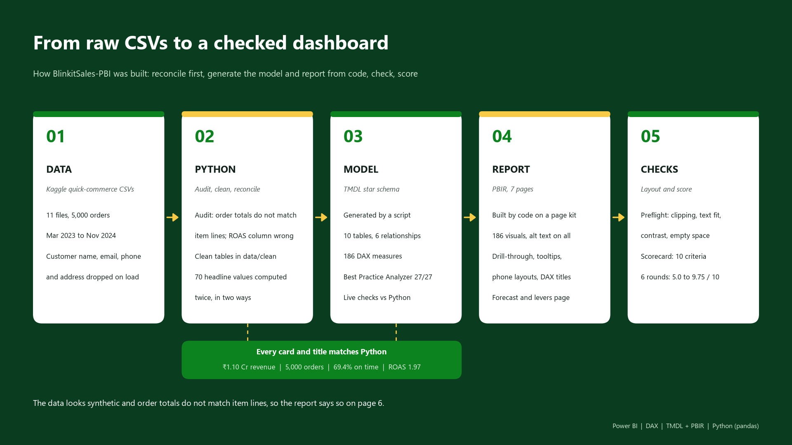

> **Read this first.** The dataset looks synthetic (flat distributions, 25 feedback sentences, one item per order) and its order totals do not match its item lines. The report says so on page 6. Treat every figure as illustrative, not as Blinkit's real performance. Amounts are shown in rupees on the assumption that the currency is INR.

## The brief, answered

| Question | Answer |
|---|---|
| **1. Sales and categories** | Revenue is **₹1.10 Cr** from 5,000 orders (average order ₹2,201.86), flat at about 255 orders a month; full months run ₹5.05 L to ₹6.23 L. By line value, Dairy & Breakfast leads with 12.9%, Pharmacy 11.9%, Fruits & Vegetables 11.2%; the top 3 hold 36%. |
| **2. Delivery vs experience** | **69.4%** of orders arrive on time (up to 5 minutes late counts as on time), so **30.6%** are late, by 14.5 minutes on average. Late orders average 3.37 stars against 3.33 for on-time orders: delay does not move the rating here. |
| **3. Marketing return** | Portfolio ROAS **1.97x** on ₹1.63 Cr spend. Email 2.05x, SMS 1.99x, Social Media 1.94x, App 1.92x: the gap (bootstrap 95%: +0.05 to +0.21x) is too small to be a strong lever. |
| **KPI: Revenue at Risk** | **₹50.42 L (45.8% of revenue)** sits in orders that were late or rated 1-2 stars. Orders x poor-experience rate x average value of those orders. |

## Key findings

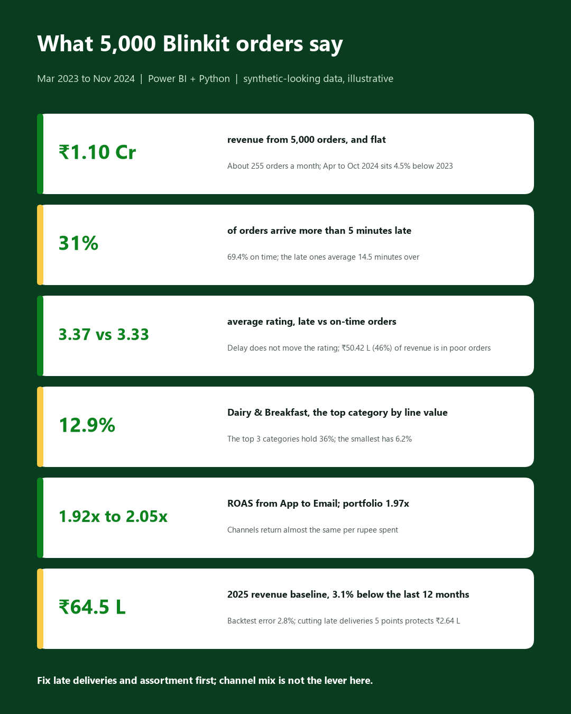

1. **Sales are flat.** About 255 orders a month; Apr to Oct 2024 runs 4.5% below the same months of 2023.
2. **One delivery in three misses the promise.** 30.6% are more than 5 minutes late.
3. **Delay does not move the rating** (3.37 vs 3.33), yet 45.8% of revenue is in poor-experience orders: 53% late only, 33% low rating only, 14% both.
4. **Categories are evenly spread.** The smallest is Instant & Frozen Food at 6.2% of line value.
5. **Channels return almost the same.** Marketing "attributed revenue" is 2.9x the order revenue, so it cannot be tied to orders.

### Forecast and levers (page 7)

A naive last-full-month model won a rolling-origin backtest (MAPE 2.8%). Baseline: ₹5.38 L a month, 2025 total ₹64.52 L (80% range ₹61.32 L to ₹67.72 L), 3.1% below the last 12 full months (₹66.60 L).

| Lever (basis Nov 2023 to Oct 2024) | Annual value |
|---|---|
| Cut late deliveries by 5 points | ₹2.64 L revenue no longer at risk |
| Cut 1-2 star ratings by 5 points | ₹2.31 L |
| Both cuts together (one scenario, not the sum) | ₹5.12 L |
| Move 20% of App spend to Email | ₹67,456 attributed revenue |
| Cut stock damage by 0.5 points | ₹43,325 stock value |

Values are not additive across types; confidence is low because delay and rating are unrelated in this data. See `docs/forecast_levers.md`.

### Data science review: what the data can and cannot support

After the dashboard I tested 15 questions with proper statistics (`analysis/ds_review.py`, write-up in
[docs/data_science_review.md](docs/data_science_review.md)). Most expected relationships are absent, which is the
strongest sign the data was generated at random:

| Question | Result |
|---|---|
| Does a late delivery lower the rating? | No: +0.04 stars (95% CI −0.03 to +0.11); none of 18 drivers is significant |
| Does a poor experience stop the next order? | Not detectably: 60-day reorder 16.9% vs 18.4%, odds ratio 0.90 (CI 0.77 to 1.05, p = 0.19); a null result with real uncertainty, not proof of no effect |
| What makes deliveries late? | Nothing measured: about 30% late at every distance (+0.05 min/km, p = 0.64), hour, area or category |
| Does more marketing spend bring more revenue? | No: elasticity −0.01 (CI −0.04 to 0.01); ROAS falls with spend only because revenue stays flat |
| Is there trend or seasonality? | No (p = 0.11 over 19 months); months vary within ±11% |

So the "revenue at risk" figure is revenue *exposed* to poor experiences, not revenue that will be lost. The
recommendations become tests rather than fixes: a marketing incrementality holdout (239 units per arm for a 10% revenue
effect), a day-90 win-back test (about 1,000 per arm for +5 points of reorder; the 2,172 customers here can detect
about +4.8), and better data capture first (order items, repeating store and rider IDs, valid registration dates).
All ₹ sizings in the review are illustrative.

## The report

| Page | Dashboard |
|---|---|
| 1 Overview | 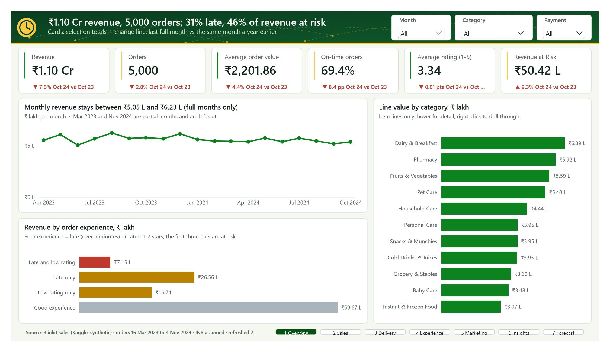 |
| 2 Sales | 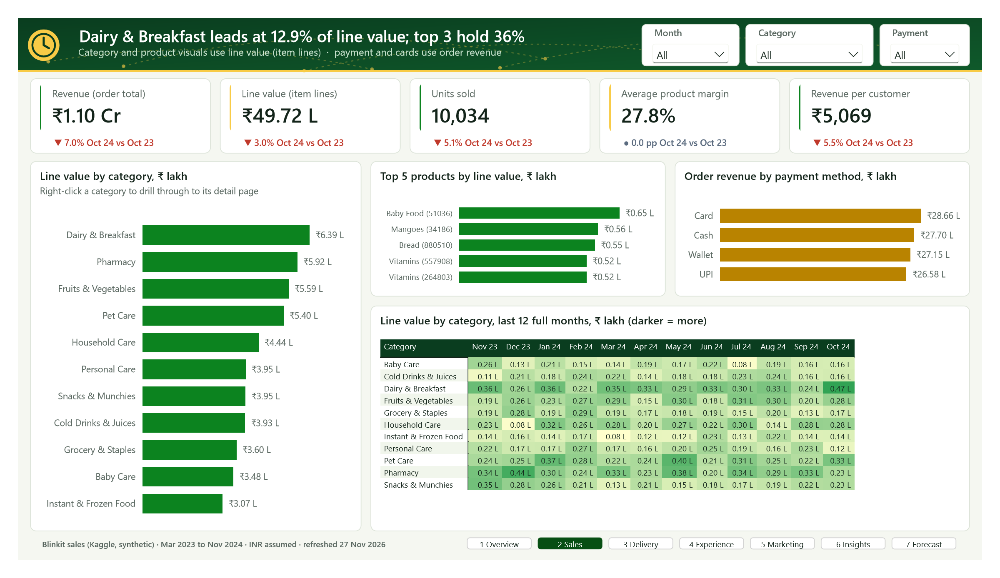 |
| 3 Delivery | 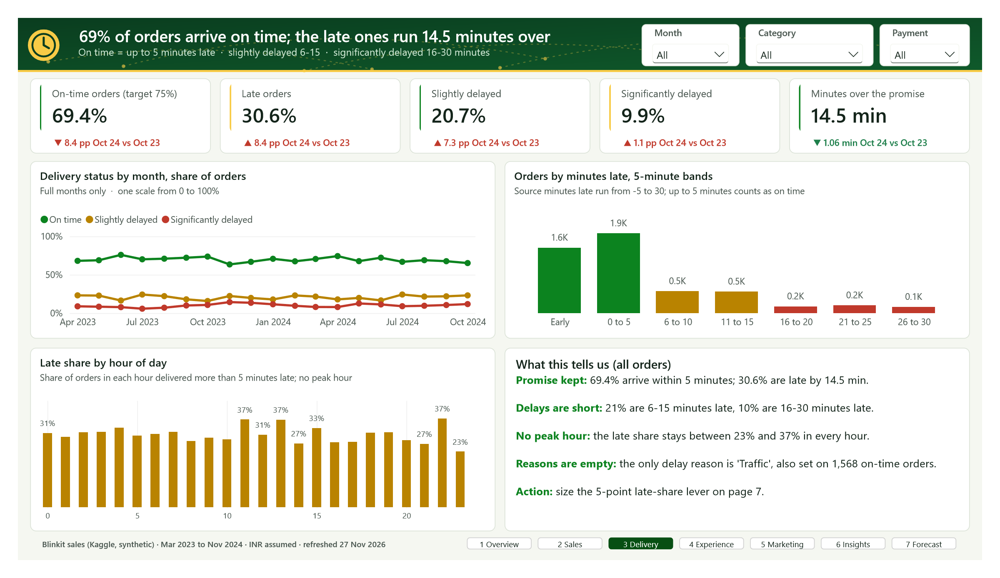 |
| 4 Experience | 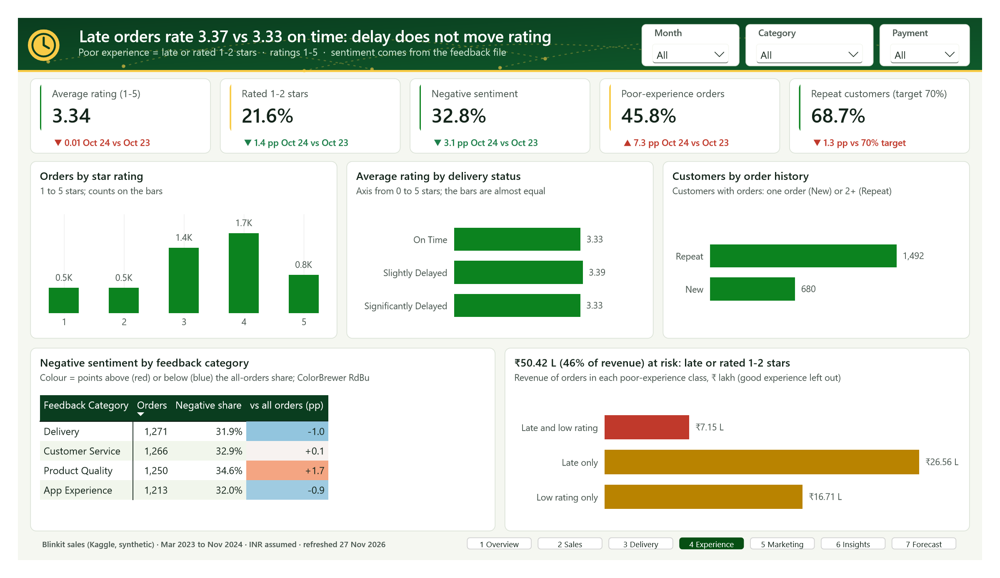 |
| 5 Marketing | 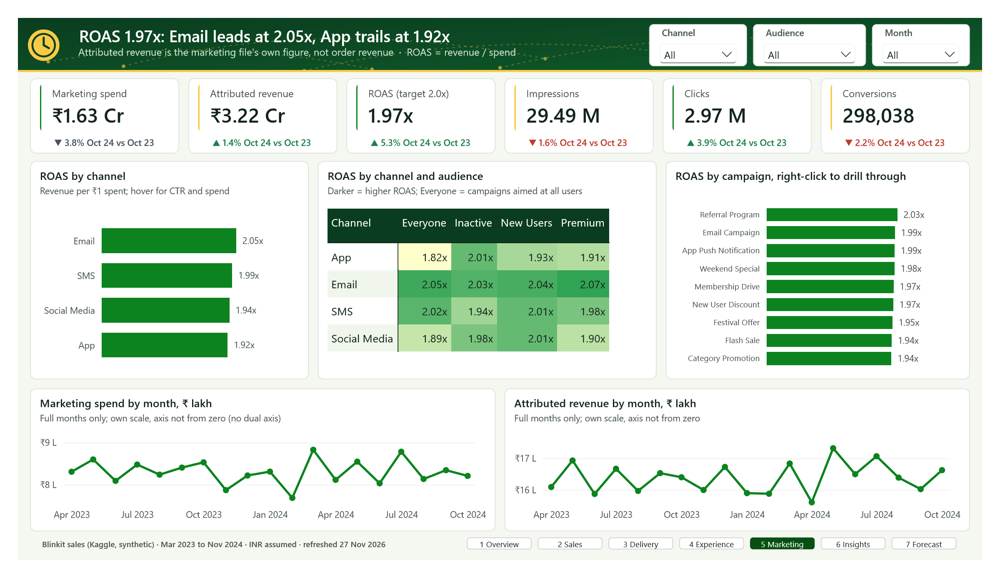 |
| 6 Insights and data notes | 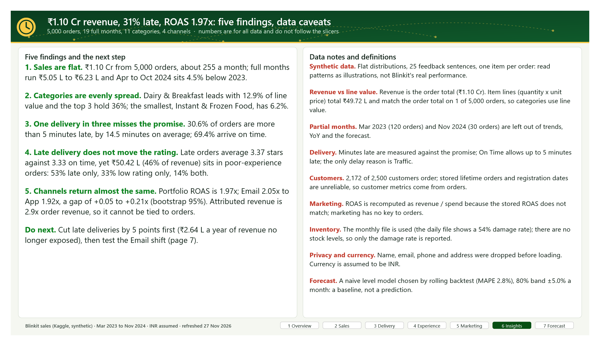 |
| 7 Forecast and levers | 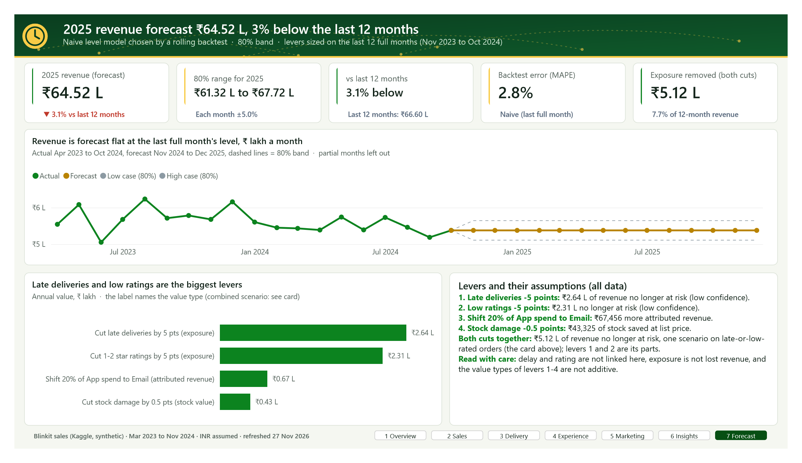 |

Also: hidden drill-through pages (Category detail, Campaign detail), two tooltip pages, phone layouts, slicers synced across pages 1 to 4, and action titles that are DAX measures, so they change with the slicers. Blinkit green and yellow brand palette, ColorBrewer sequential and diverging scales for magnitudes and variances.

## Analysis notebooks

Six executed notebooks in `analysis/` (load and clean, audit, EDA, forecast, key questions, deep dives) turn the data into 29 charts, listed with their one-line findings in `docs/analysis_gallery.md`. Style and palette live in `analysis/viz_style.py`; run everything with `python analysis/_make_notebooks.py`. No personal field is ever loaded. Four results worth a look:

| | |
|---|---|
| 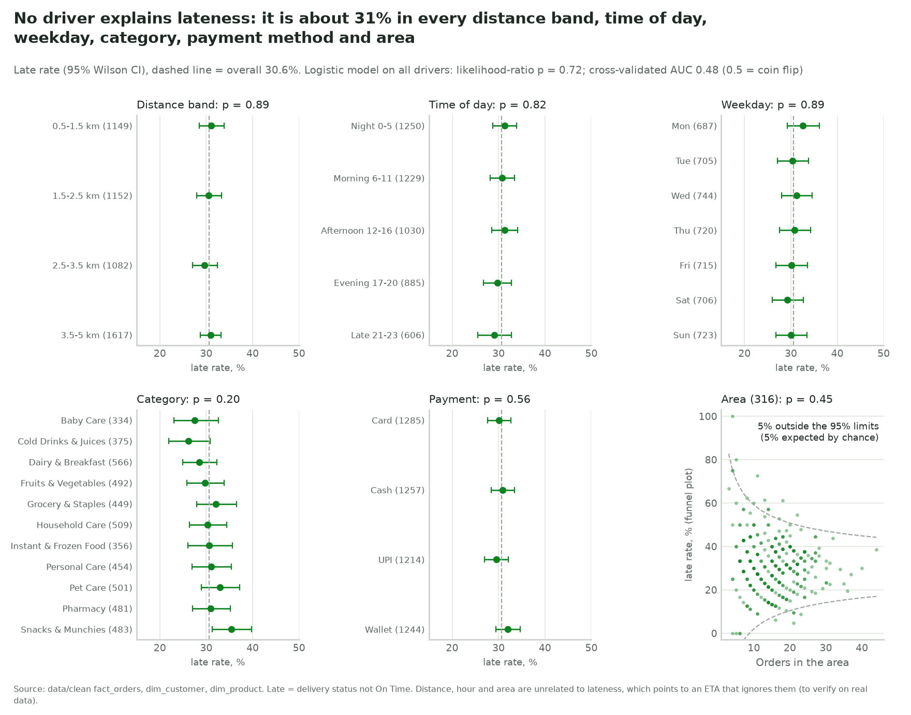 | 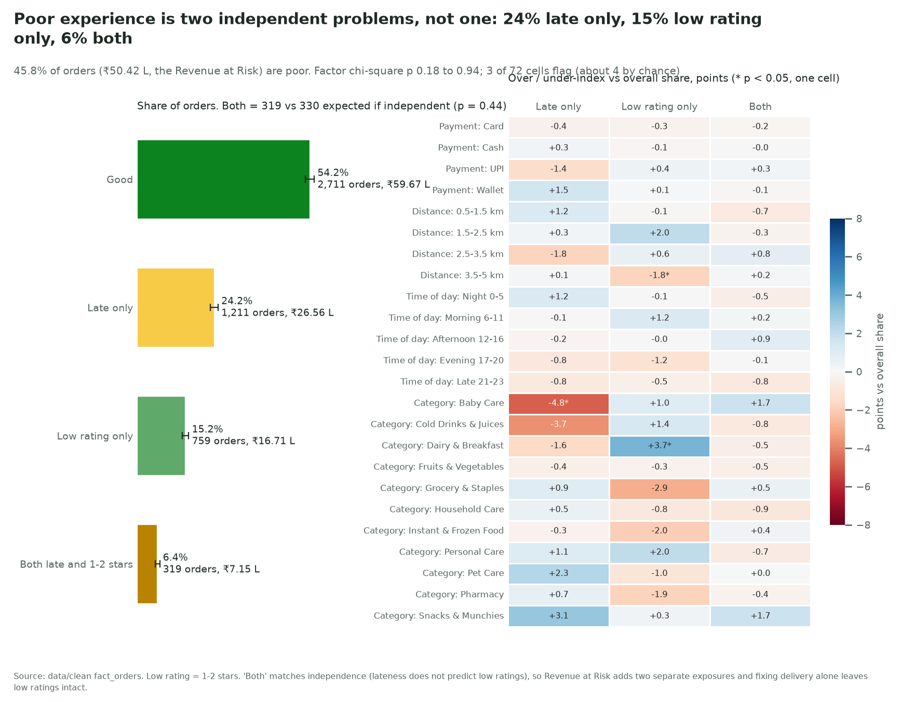 |
| Lateness is about 30.6% in every slice (distance, hour, weekday, category, payment, area): no driver, cross-validated AUC 0.48. | Poor experience is 24% late only, 15% low rating only and 6% both; the two problems are independent. |
| 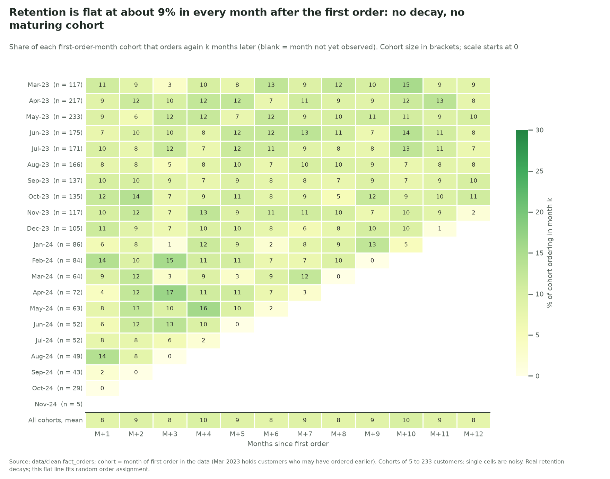 | 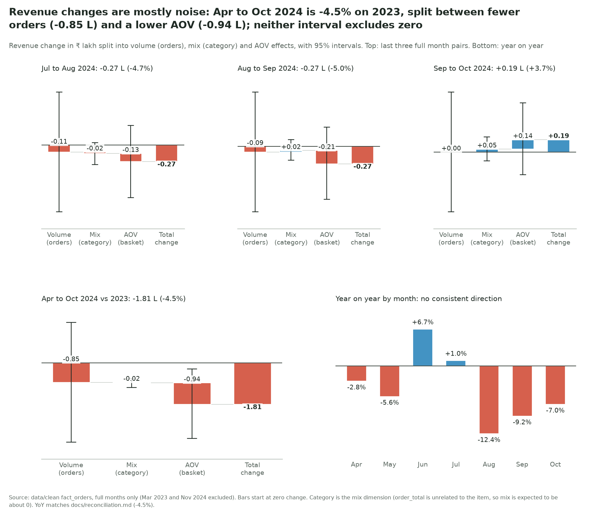 |
| Cohort retention is flat at about 9% a month: no decay, no maturing cohort. | Apr to Oct 2024 is -4.5% on 2023, split between volume and AOV, with every interval including zero. |

Also in the gallery: RFM segments (Champions 22% of customers, 37% of revenue, the same as random assignment), Pareto curve (top 20% hold 41%), discount depth, marketing funnel and inventory damage. Most "no effect" results describe the synthetic-looking source, not Blinkit.

## How it is built

```
Kaggle CSVs (data/raw, not in git)
  -> _build/audit.py        audit findings                 -> docs/audit.md
  -> _build/prepare.py      clean star tables, PII dropped -> data/clean
  -> _build/reconcile.py    70 values, two code paths      -> docs/reconciliation.md
  -> _build/forecast.py     backtested forecast, levers    -> data/clean, docs/forecast_levers.md
  -> _build/make_semantic_model.py   TMDL model, 186 measures, parameters
  -> _build/build_report.py          PBIR report on _build/pbir_kit.py + blinkit_theme.py
  -> _build/bpa_check.py, check_measures.py, check_report.py   model, DAX and layout checks
  -> docs/review/scorecard.md        10-criterion score, fix, re-score
```

**Model.** Star schema: `fact_orders` (order grain, with delivery and feedback merged 1:1), `fact_marketing`, `fact_inventory` (product by month), `dim_product`, `dim_customer`, a generated `Date` table, a `_Measures` table, and disconnected `Forecast`, `Levers` and `Refresh Info` tables. 10 tables, 6 relationships, one-to-many, single direction. The data source is CSV through the Power Query parameters `ProjectFolder` and `SourceFolder`, with no hard-coded paths.

## Quality

- **Reconciliation.** 70 headline values computed independently from raw and clean data and asserted equal (`docs/reconciliation.md`); about 36 live DAX checks against the open model pass (`docs/live_checks.md`).
- **Best Practice Analyzer.** 27 of 27 rules pass (`python _build/bpa_check.py BlinkitSales-PBI.SemanticModel/definition`).
- **Preflight.** `check_report.py` checks page margins, text fit, card and matrix sizes, contrast and empty space before every export.
- **Scorecard.** 9.75/10 after six rounds (`docs/review/scorecard.md`). History: 5.0, 7.0, 7.0, 8.5, 7.0 (a text overflow capped the score), 9.75.

## Data caveats

1. **Synthetic-looking data.** Flat distributions, 25 feedback sentences, one item per order, delay and rating uncorrelated. Figures are illustrative.
2. **Order totals do not match item lines.** `order_total` equals quantity x unit price on 1 of 5,000 orders (₹1.10 Cr vs ₹49.72 L). Revenue uses the order total; categories use "line value" and are labelled so.
3. **Marketing is a separate star.** Attributed revenue (₹3.22 Cr) is 2.9x order revenue and has no key to orders. ROAS is recomputed as revenue / spend because the stored column does not match.
4. **Partial months.** Mar 2023 (120 orders) and Nov 2024 (30 orders) are left out of trends, year-on-year and the forecast.
5. **Delivery and customers.** "On Time" allows up to 5 minutes late; the only delay reason is "Traffic". Stored customer totals and registration dates are unreliable, so customer metrics come from orders. Store and rider ids are unique per order, so there is no store or rider analysis.
6. **Privacy.** Customer name, email, phone and address are dropped in the Python load step and never reach the model, the report or git.

## Reproduce

1. Download the Kaggle dataset `akxiit/blinkit-sales-dataset` into `data/raw/` (not included here; it keeps its own terms on Kaggle).
2. `pip install -r requirements.txt`
3. `python _build/prepare.py`, then `python _build/reconcile.py` and `python _build/forecast.py`.
4. `python _build/make_semantic_model.py` and `python _build/build_report.py` (close Power BI Desktop first).
5. Open `BlinkitSales-PBI.pbip` in Power BI Desktop, set the `ProjectFolder` and `SourceFolder` parameters if asked, then Home > Refresh and save.
6. Optional: `python _build/bpa_check.py BlinkitSales-PBI.SemanticModel/definition`, `python _build/check_report.py`, `python analysis/_make_notebooks.py` (needs the packages below), `python _build/make_project_guide.py`.

`docs/BlinkitSales-PBI_Project_Guide.pdf` walks through every step with diagrams and screenshots.

## Toolkit and licence

Built with the [powerbi-modelling-mcp](https://github.com/divitgautam/powerbi-modelling-mcp) toolkit (v1.1.0). Code and documents: MIT (see `LICENSE`). The Kaggle dataset is not redistributed.
